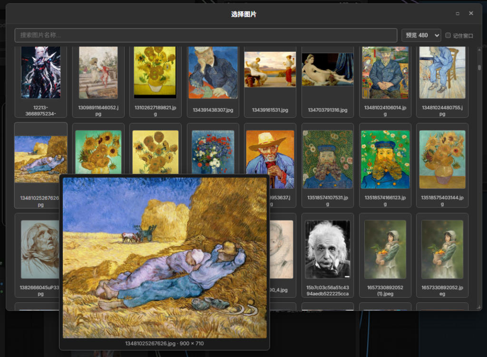

# ComfyUI Browser Load Image

Enhanced Load Image / Video nodes for [ComfyUI](https://github.com/comfyanonymous/ComfyUI) with a visual browser interface.




## ✨ Features

- **Visual Media Browser** — Browse and select images/videos from the input folder with a thumbnail grid modal
- **Hover Preview** — Hover over any thumbnail to see a large preview with filename and original dimensions
- **Configurable Preview Size** — Choose preview size from dropdown (320 / 480 / 640 / 768 / 1024)
- **Draggable Modal** — Drag the title bar to reposition the modal
- **Resizable Modal** — Drag the bottom-right corner to resize (min 400×300)
- **Maximize Button** — Click □ to toggle fullscreen
- **Remember Layout** — Check "记住窗口" to persist your preferred window position and size
- **Search & Filter** — Real-time search to quickly find files by name
- **Keyboard Navigation** — Arrow keys, PageUp/Down, Home/End for scrolling; ESC to close

## 📦 Included Nodes

| Node | Description | Output |
|------|-------------|--------|
| **Browser Load Image** | Load images with visual browser | IMAGE, MASK |
| **Browser Load Video to Image** | Convert video to image sequence | IMAGE, INT, INT |
| **Browser Load Video** | Load video (standard VIDEO type) | VIDEO |

## 🔧 Installation

### Option 1: ComfyUI Manager (Recommended)

Search for `ComfyUI_BrowserLoadImage` in [ComfyUI Manager](https://github.com/ltdrdata/ComfyUI-Manager) and install.

### Option 2: Manual Installation

```bash
cd ComfyUI/custom_nodes
git clone https://github.com/flashcol/ComfyUI_BrowserLoadImage.git
cd ComfyUI_BrowserLoadImage
pip install -r requirements.txt
```

Restart ComfyUI after installation.

### Dependencies

- **Image node**: No extra dependencies (uses PIL/Pillow included with ComfyUI)
- **Video nodes**: Requires `opencv-python` (`pip install opencv-python`)

## 🖱️ Usage

1. Add a **Browser Load Image** node to your workflow
2. Click the **"浏览图片"** (Browse Images) button
3. Browse, search, and click a thumbnail to select it
4. The selected file is set as the node's input

## 📁 Project Structure

```
ComfyUI_BrowserLoadImage/
├── __init__.py              # Plugin entry point
├── nodes/
│   ├── utils.py             # Shared utilities
│   ├── browser_load_image.py
│   ├── browser_load_video.py
│   └── browser_load_video_standard.py
├── web/
│   ├── js/browserLoadImage.js   # Frontend extension
│   └── css/browserLoadImage.css # Stylesheet reference
├── config/settings.py       # Constants
└── tests/test_nodes.py      # Unit tests
```

## 🧪 Running Tests

```bash
cd ComfyUI/custom_nodes/ComfyUI_BrowserLoadImage
python -m pytest tests/ -v
```

## 📄 License

[MIT License](LICENSE)


## 文件管理（删除 / 分组 / 重命名）

浏览弹窗内支持对 `input/` 目录直接管理文件：

- **子文件夹分组**：仅支持一级子文件夹；点击文件夹卡片进入，顶部面包屑返回；搜索会覆盖所有文件夹。
- **新建文件夹**：工具栏「新建文件夹」。
- **删除**：卡片右上角 ✕，或开启「管理」后多选并按 `Delete`。文件和文件夹都会被移入 `input/.trash/`，不会永久删除，可手动找回。
- **移动**：开启「管理」，多选文件后点「移动到…」；目标有同名文件时自动加 ` (1)` 后缀，不会覆盖。
- **重命名**：卡片右上角 ✎，或「管理」模式下选中一项按 `F2`；文件扩展名不可修改。

> 移动、重命名会改变文件路径，其他已保存的工作流中引用旧路径的节点将找不到文件。
